  <picture>
    <source media="(prefers-color-scheme: dark)" srcset="https://raw.githubusercontent.com/LynnChrysteiin/LynnChrysteiin/output/contributions-dark.svg" />
    
  </picture>
  
Powered by <a href=https://github.com/LynnChrysteiin/astribution>Astribution</a>.

<h1 align="center">Hi, I'm AstraluX ✨</h1>

  <a href="#repos">仓库</a> ·
  <a href="#languages">语言</a> ·
  <a href="#devices">设备</a>

## 💾 Repos · 仓库

1. **本页面**

    

2. **[*DeepSeek Harness*](https://www.deepseek.com/harness) 插件**

    

3. **[*RimWorld*](https://store.steampowered.com/app/294100) Mod**

   

4. **C++ & EasyX 玩具**

   

5. **跟随 [*Voidmatrix*](https://github.com/VoidmatrixHeathcliff) 教程制作的 C++ 游戏 Demo**

    

## 📝 Language · 语言

  ![C#](https://img.shields.io/badge/-C%23-9179e4?style=flat-square&logo=data:image/svg%2bxml;base64,PHN2ZyB4bWxucz0iaHR0cDovL3d3dy53My5vcmcvMjAwMC9zdmciICB2aWV3Qm94PSIwIDAgNTAgNTAiIHdpZHRoPSI1MDBweCIgaGVpZ2h0PSI1MDBweCI+PHBhdGggZD0iTSAyNSAyIEMgMjQuMjg1MTU2IDIgMjMuNTcwMzEzIDIuMTc5Njg4IDIyLjkzMzU5NCAyLjUzOTA2MyBMIDYuMDg5ODQ0IDEyLjAwMzkwNiBDIDQuODAwNzgxIDEyLjcyNjU2MyA0IDE0LjA4MjAzMSA0IDE1LjUzNTE1NiBMIDQgMzQuNDY0ODQ0IEMgNCAzNS45MTc5NjkgNC44MDA3ODEgMzcuMjczNDM4IDYuMDg5ODQ0IDM3Ljk5NjA5NCBMIDIyLjkzMzU5NCA0Ny40NjA5MzggQyAyMy41NzAzMTMgNDcuODIwMzEzIDI0LjI4NTE1NiA0OCAyNSA0OCBDIDI1LjcxNDg0NCA0OCAyNi40Mjk2ODggNDcuODIwMzEzIDI3LjA2NjQwNiA0Ny40NjA5MzggTCA0My45MTAxNTYgMzggQyA0NS4xOTkyMTkgMzcuMjczNDM4IDQ2IDM1LjkxNzk2OSA0NiAzNC40NjQ4NDQgTCA0NiAxNS41MzUxNTYgQyA0NiAxNC4wODIwMzEgNDUuMTk5MjE5IDEyLjcyNjU2MyA0My45MTAxNTYgMTIuMDAzOTA2IEwgMjcuMDY2NDA2IDIuNTM5MDYzIEMgMjYuNDI5Njg4IDIuMTc5Njg4IDI1LjcxNDg0NCAyIDI1IDIgWiBNIDI1IDEzIEMgMjguNzgxMjUgMTMgMzIuMjc3MzQ0IDE0Ljc1MzkwNiAzNC41NDI5NjkgMTcuNzM4MjgxIEwgMzAuMTYwMTU2IDIwLjI3NzM0NCBDIDI4Ljg0Mzc1IDE4LjgzNTkzOCAyNi45NzI2NTYgMTggMjUgMTggQyAyMS4xNDA2MjUgMTggMTggMjEuMTQwNjI1IDE4IDI1IEMgMTggMjguODU5Mzc1IDIxLjE0MDYyNSAzMiAyNSAzMiBDIDI2Ljk3MjY1NiAzMiAyOC44NDM3NSAzMS4xNjQwNjMgMzAuMTYwMTU2IDI5LjcyMjY1NiBMIDM0LjU0Mjk2OSAzMi4yNjE3MTkgQyAzMi4yNzczNDQgMzUuMjQ2MDk0IDI4Ljc4MTI1IDM3IDI1IDM3IEMgMTguMzgyODEzIDM3IDEzIDMxLjYxNzE4OCAxMyAyNSBDIDEzIDE4LjM4MjgxMyAxOC4zODI4MTMgMTMgMjUgMTMgWiBNIDM1IDIwIEwgMzcgMjAgTCAzNyAyMiBMIDM5IDIyIEwgMzkgMjAgTCA0MSAyMCBMIDQxIDIyIEwgNDMgMjIgTCA0MyAyNCBMIDQxIDI0IEwgNDEgMjYgTCA0MyAyNiBMIDQzIDI4IEwgNDEgMjggTCA0MSAzMCBMIDM5IDMwIEwgMzkgMjggTCAzNyAyOCBMIDM3IDMwIEwgMzUgMzAgTCAzNSAyOCBMIDMzIDI4IEwgMzMgMjYgTCAzNSAyNiBMIDM1IDI0IEwgMzMgMjQgTCAzMyAyMiBMIDM1IDIyIFogTSAzNyAyNCBMIDM3IDI2IEwgMzkgMjYgTCAzOSAyNCBaIiBmaWxsPSIjRkZGRkZGIi8+PC9zdmc+&logoColor=fff) 

## 💻 Devices · 设备

   

<!--
**LynnChrysteiin/LynnChrysteiin** is a ✨ _special_ ✨ repository because its `README.md` (this file) appears on your GitHub profile.
-->
